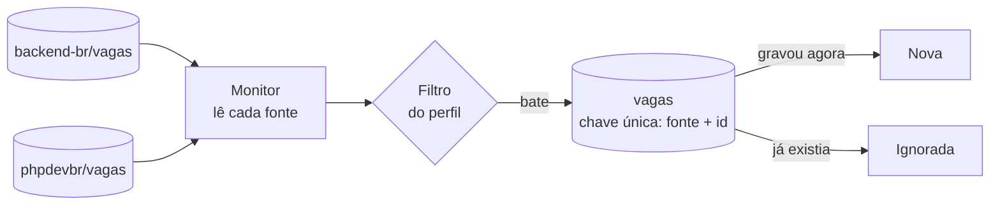

# Monitor de vagas

[](https://github.com/Canhao43/monitor-de-vagas/actions/workflows/ci.yml)

Um comando Laravel que lê fontes de vagas, filtra pelo perfil de quem procura e guarda só as que nunca viu. Roda sozinho, de hora em hora, no agendador do sistema, e (a partir do M3) avisa no Telegram **só as vagas novas**, nunca a mesma duas vezes.

Feito para uso real: o autor está procurando vaga e usa o monitor.

> Construído com agentes de IA (Claude Code) e revisado por mim em cada PR. As regras que os agentes seguem estão em [`CLAUDE.md`](CLAUDE.md).

## Roteiro

| Marco | O que entra | Estado |
|---|---|---|
| **M1** | Vaga, filtro e deduplicação, com a primeira fonte: repositórios de vagas do GitHub | 🟡 em revisão |
| **M2** | Gupy e Remotive como fontes; uma fonte fora do ar não derruba as outras | — |
| **M3** | Aviso no Telegram, só depois de confirmado o envio; chave de desligar | — |
| **M4** | Agendamento no Windows, registro de decisões e README final | — |

## Como rodar

Precisa de PHP 8.4 e Composer.

```bash
git clone https://github.com/Canhao43/monitor-de-vagas.git
cd monitor-de-vagas
composer install
cp .env.example .env && php artisan key:generate
touch database/database.sqlite
php artisan migrate

php artisan vagas:verificar --simular   # mostra o que seria novo, sem gravar
php artisan vagas:verificar             # grava as novas
```

> **Windows:** se aparecer `cURL error 60`, o PHP não tem a lista de certificados. Aponte `curl.cainfo` e `openssl.cafile` no `php.ini` para um pacote de certificados (o Git para Windows traz um em `C:\Program Files\Git\usr\ssl\certs\ca-bundle.crt`).

## O perfil

Tudo no `.env`, sem mexer em código:

| Variável | Padrão | O que faz |
|---|---|---|
| `VAGAS_TERMOS` | `php,laravel,back-end,backend,protheus` | A vaga entra se o título ou os rótulos tiverem ao menos um |
| `VAGAS_EXCLUIR` | `estagio,estagiario,trainee,junior,jr` | A vaga sai se tiver algum |
| `VAGAS_SOMENTE_REMOTAS` | `true` | Vaga que não diz se é remota conta como não remota |
| `VAGAS_GITHUB_REPOSITORIOS` | `backend-br/vagas,phpdevbr/vagas` | Repositórios em que cada vaga é uma issue aberta |
| `VAGAS_GITHUB_TOKEN` | vazio | Opcional. Sem ele, a API pública do GitHub dá 60 requisições por hora |

A comparação ignora maiúscula e acento e usa palavra inteira: `php` não casa com `PHPUnit`, e `jr` não tira uma vaga da "Jrsoft".

## Como funciona



## Decisões até aqui

| Decisão | Por quê | Descartado |
|---|---|---|
| **Quem decide se a vaga é nova é a chave única** (fonte + id da vaga na fonte) | Duas execuções ao mesmo tempo não gravam, nem avisam, a mesma vaga duas vezes. A segunda gravação bate na chave e conta como "já vista" | Consultar antes de gravar: entre a consulta e a gravação, outra execução pode gravar |
| **Requisição condicional no GitHub** (`If-None-Match` com o ETag) | Se nada mudou, a resposta é `304`, sem corpo: nenhuma vaga nova para ver | Baixar tudo a cada execução |
| **O ETag só é guardado depois que as vagas foram gravadas** | Guardado antes, uma falha na gravação faria a próxima execução receber `304` e perder essas vagas para sempre | Guardar ao receber a resposta |
| **Uma fonte que falha não derruba as outras** | Cada fonte roda isolada; a falha fica no resultado e no log. O comando só falha se todas falharem | Parar no primeiro erro |
| **`--simular` não grava nem guarda o ETag** | A execução de verdade seguinte vê exatamente o mesmo que a simulação mostrou | Simular gravando e apagando depois |
| **Filtro em título e rótulos** | O `backend-br` marca o nível ("Júnior", "Pleno") e o modelo ("Remoto") como rótulos, não no título | Só o título |
| **Remota desconhecida não passa** quando o perfil exige remota | Melhor perder uma vaga ambígua do que avisar uma presencial | Tratar desconhecida como remota |
| **O CI lê as fontes de verdade, em modo simulação** | Os testes usam respostas gravadas. Só a chamada real pega uma mudança de formato da fonte | Só testes com resposta gravada |

## Limites conhecidos

- `back-end` no perfil traz vagas de outras stacks (Java, Node, .NET). Tirar o termo de `VAGAS_TERMOS` deixa só PHP, Laravel e Protheus.
- Na primeira execução, toda vaga aberta que bate com o perfil é "nova". O M3 decide como avisar essa carga inicial sem mandar dezenas de mensagens.
- Vaga fechada na fonte continua no banco: o monitor não apaga nada.
