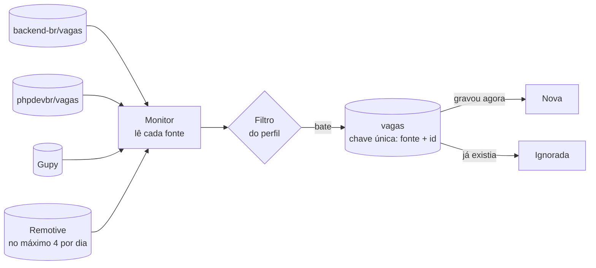

# Monitor de vagas

[](https://github.com/Canhao43/monitor-de-vagas/actions/workflows/ci.yml)

Um comando Laravel que lê fontes de vagas, filtra pelo perfil de quem procura e guarda só as que nunca viu. Roda sozinho, de hora em hora, no agendador do sistema, e (a partir do M3) avisa no Telegram **só as vagas novas**, nunca a mesma duas vezes.

Feito para uso real: o autor está procurando vaga e usa o monitor.

> Construído com agentes de IA (Claude Code) e revisado por mim em cada PR. As regras que os agentes seguem estão em [`CLAUDE.md`](CLAUDE.md).

## Roteiro

| Marco | O que entra | Estado |
|---|---|---|
| **M1** | Vaga, filtro e deduplicação, com a primeira fonte: repositórios de vagas do GitHub | ✅ |
| **M2** | Gupy e Remotive como fontes, intervalo mínimo por fonte, filtro de região e de idade | ✅ |
| **M3** | Aviso no Telegram, só depois de confirmado o envio; chave de desligar | ✅ |
| **M4** | Agendamento no Windows, registro de decisões ([14 ADRs](docs/decisoes/README.md), conferidos pelo build) e README final | 🟡 em revisão |

## Como rodar

Precisa de PHP 8.4 e Composer.

```bash
git clone https://github.com/Canhao43/monitor-de-vagas.git
cd monitor-de-vagas
composer install
cp .env.example .env && php artisan key:generate
touch database/database.sqlite
php artisan migrate

php artisan vagas:verificar --simular   # mostra o que seria novo, sem gravar
php artisan vagas:verificar             # grava as novas
```

> **Windows:** se aparecer `cURL error 60`, o PHP não tem a lista de certificados. Aponte `curl.cainfo` e `openssl.cafile` no `php.ini` para um pacote de certificados (o Git para Windows traz um em `C:\Program Files\Git\usr\ssl\certs\ca-bundle.crt`).

## Avisos no Telegram

1. No Telegram, fale com o [@BotFather](https://t.me/BotFather), mande `/newbot` e escolha um nome e um usuário terminado em `bot`. Ele responde com o token.
2. No terminal, na pasta do projeto: `php artisan vagas:configurar-telegram`. O comando pede o token **com a digitação escondida**, confere o bot, pede um `/start` na conversa com ele, descobre o seu chat e grava `TELEGRAM_BOT_TOKEN`, `TELEGRAM_CHAT_ID` e `VAGAS_AVISOS_ATIVOS=true` no `.env`. No fim, manda uma mensagem de teste.

O token vai do BotFather para o terminal, e do terminal só para o `.env`, que o git ignora. Não passa por chat, log nem código.

Depois disso, cada `vagas:verificar` (sem `--simular`) manda as vagas novas numa mensagem, com até 10 por mensagem. `VAGAS_AVISOS_ATIVOS=false` desliga os avisos sem parar o monitor: as vagas continuam sendo gravadas e o aviso delas fica pendente.

## Rodar sozinho, de hora em hora (Windows)

```powershell
powershell -ExecutionPolicy Bypass -File scripts\agendar-no-windows.ps1
```

Registra a tarefa **Monitor de vagas** no Agendador de Tarefas: de hora em hora, só com o usuário logado (não guarda senha), sem janela piscando, sem duas execuções ao mesmo tempo e começando assim que o PC ligar se a hora marcada passou. Cada execução deixa uma linha no log diário em `storage\logs`, guardado por 14 dias. Para desfazer: `scripts\desagendar-no-windows.ps1`.

## O perfil

Tudo no `.env`, sem mexer em código:

| Variável | Padrão | O que faz |
|---|---|---|
| `VAGAS_TERMOS` | `php,laravel,protheus` | A vaga entra se o título (ou os rótulos, no GitHub) tiver ao menos um |
| `VAGAS_EXCLUIR` | `estagio,estagiario,trainee,junior,jr,banco de talentos` | A vaga sai se tiver algum |
| `VAGAS_DIAS_MAXIMOS` | `30` | Vaga publicada há mais tempo provavelmente já foi preenchida |
| `VAGAS_REGIOES_ACEITAS` | `worldwide,anywhere,brazil,brasil,latam,latin america,americas,south america` | Só para vaga que restringe de onde aceita candidato ("USA Only" sai) |
| `VAGAS_SOMENTE_REMOTAS` | `true` | Vaga que não diz se é remota conta como não remota |
| `VAGAS_GITHUB_REPOSITORIOS` | `backend-br/vagas,phpdevbr/vagas` | Repositórios em que cada vaga é uma issue aberta |
| `VAGAS_GITHUB_TOKEN` | vazio | Opcional. Sem ele, a API pública do GitHub dá 60 requisições por hora |
| `VAGAS_GUPY_ATIVA` / `VAGAS_GUPY_BUSCAS` | `true` / `php,laravel,protheus` | A busca da Gupy é pelo título: um pedido por termo |
| `VAGAS_REMOTIVE_ATIVA` / `VAGAS_REMOTIVE_CATEGORIA` | `true` / `software-dev` | Um pedido só, pela categoria; o filtro faz o resto |

A comparação ignora maiúscula e acento e usa palavra inteira: `php` não casa com `PHPUnit`, e `jr` não tira uma vaga da "Jrsoft".

## Como funciona



## Decisões

O registro completo está em [`docs/decisoes`](docs/decisoes/README.md): 14 ADRs, cada um com as alternativas descartadas e o teste ou a etapa do CI que o prova. Um teste quebra o build se um ADR citar uma prova que não existe. Abaixo, o resumo.

| Decisão | Por quê | Descartado |
|---|---|---|
| **Quem decide se a vaga é nova é a chave única** (fonte + id da vaga na fonte) | Duas execuções ao mesmo tempo não gravam, nem avisam, a mesma vaga duas vezes. A segunda gravação bate na chave e conta como "já vista" | Consultar antes de gravar: entre a consulta e a gravação, outra execução pode gravar |
| **Requisição condicional no GitHub** (`If-None-Match` com o ETag) | Se nada mudou, a resposta é `304`, sem corpo: nenhuma vaga nova para ver | Baixar tudo a cada execução |
| **O ETag só é guardado depois que as vagas foram gravadas** | Guardado antes, uma falha na gravação faria a próxima execução receber `304` e perder essas vagas para sempre | Guardar ao receber a resposta |
| **Uma fonte que falha não derruba as outras** | Cada fonte roda isolada; a falha fica no resultado e no log. O comando só falha se todas falharem | Parar no primeiro erro |
| **`--simular` não grava nem guarda o ETag** | A execução de verdade seguinte vê exatamente o mesmo que a simulação mostrou | Simular gravando e apagando depois |
| **Filtro em título e rótulos** | O `backend-br` marca o nível ("Júnior", "Pleno") e o modelo ("Remoto") como rótulos, não no título | Só o título |
| **Remota desconhecida não passa** quando o perfil exige remota | Melhor perder uma vaga ambígua do que avisar uma presencial | Tratar desconhecida como remota |
| **O CI lê as fontes de verdade, em modo simulação** | Os testes usam respostas gravadas. Só a chamada real pega uma mudança de formato da fonte | Só testes com resposta gravada |
| **Cada fonte tem um intervalo mínimo entre leituras** (GitHub: nenhum; Gupy: 1 h; Remotive: 6 h) | O monitor roda de hora em hora, mas os termos do Remotive pedem no máximo 4 leituras por dia. Só a leitura que deu certo marca o relógio: a que falhou é tentada na execução seguinte | Rodar o monitor 4 vezes por dia para todas as fontes, atrasando as que não têm limite |
| **A simulação respeita o intervalo, mas não marca o relógio** | Uma leitura simulada também é uma leitura para o Remotive. E a execução de verdade seguinte não deve ficar sem ler | Simulação sem limite nenhum |
| **No Remotive, um pedido só, pela categoria** | Um pedido por termo multiplicaria as leituras que os termos limitam. O filtro do perfil separa o que interessa | Um pedido por termo, como na Gupy |
| **No Remotive, o filtro olha só o título** | Os rótulos de lá são amplos demais: uma vaga de assistente de escritório vem com `php` | Usar os rótulos, como no GitHub |
| **O Remotive fica fora da leitura de verdade no CI** | Os runners do GitHub dividem IP: cada push gastaria uma das 4 leituras do dia. O formato dele é coberto pelo teste com resposta gravada | Ler o Remotive a cada push |
| **A Gupy é lida sem disfarce de navegador** | É o endereço que o próprio portal usa. Se a Gupy passar a barrar robô, a fonte sai, em vez de contornar o bloqueio | User-agent de navegador |
| **Idade máxima de 30 dias** | A Gupy devolve, na mesma busca, vagas de 2021 e páginas de empresa desativadas. Com o limite, 35 vagas viraram 11 numa leitura real | Avisar tudo o que a fonte devolve |
| **Região aceita** para vaga que restringe de onde contrata | Vaga remota "USA Only" é ruído para quem mora no Brasil | Ignorar a região |
| **Os testes nunca saem para a internet** (`Http::preventStrayRequests`) | Uma fonte esquecida no `Http::fake` ia para a rede de verdade, e o teste passava ou falhava conforme a fonte respondia. Aconteceu no M2 | Confiar que todo teste simula todas as fontes |
| **Aviso "pelo menos uma vez"**: a vaga só é marcada como avisada depois que o Telegram confirma | Se o programa cair entre o envio e a marcação, a vaga é avisada de novo. Melhor repetir um aviso do que perder uma vaga | Marcar antes de enviar ("no máximo uma vez"), que perde a vaga numa queda |
| **Vagas agrupadas: até 10 por mensagem**, sem passar do limite de 4.096 caracteres do Telegram | A primeira execução, ou a volta de um aviso desligado, não inunda o celular | Uma mensagem por vaga |
| **No primeiro erro do Telegram, inclusive o `429`, para** | O que sobrou fica pendente e vai na próxima execução, uma hora depois. Esperar o `retry_after` prenderia a execução agendada | Esperar e tentar de novo na mesma execução |
| **Cada vaga diz de que fonte veio** | Os termos do Remotive pedem isso, e serve para todas | Só o link |
| **O token entra por um comando, com a digitação escondida, e vai só para o `.env`** | Não passa por chat, log nem código. O erro do Telegram é mostrado sem a URL, que contém o token | Pedir para colar o token num arquivo, ou mandar por mensagem |
| **O chat é descoberto pelo `/start`, e só em conversa privada** | Ninguém precisa achar o próprio id. Um `/start` mandado num grupo onde o bot está não vira o destino dos avisos | Pedir o id do chat |
| **Chave de desligar sem parar o monitor** (`VAGAS_AVISOS_ATIVOS`) | Desligado, as vagas continuam sendo gravadas, e o aviso fica pendente até ligar de novo | Desligar o monitor inteiro |
| **Agendador de Tarefas do Windows, de hora em hora, sem janela** (`conhost --headless`) | Uso pessoal num PC que fica ligado: sem servidor, sem nuvem, sem depender de alguém lembrar de rodar | `schedule:run` a cada minuto (60 execuções por hora para fazer uma) · rodar deslogado, que exige guardar a senha do Windows |
| **Uma linha de log por execução, em log diário de 14 dias** | Rodando sozinho, é por ela que se confere que o monitor está vivo. Um arquivo único cresceria para sempre | Log só de erro |

## Limites conhecidos

- **A Gupy não tem API documentada**: o monitor usa o endereço que o próprio portal usa, que pode mudar sem aviso. O CI lê a Gupy de verdade a cada push para perceber cedo.
- **O Remotive mostra as vagas com 24 horas de atraso**, pelos termos de uso dele.
- Se o Telegram falhar por dias (token revogado, por exemplo), o aviso não chega e ninguém é avisado disso: fica só o alerta na saída do comando e no log.
- Vaga fechada na fonte continua no banco: o monitor não apaga nada.
- Com o PC desligado, não há leitura. A primeira execução depois de ligar recupera, enquanto as fontes ainda tiverem as vagas.

## Licença

[MIT](LICENSE).
